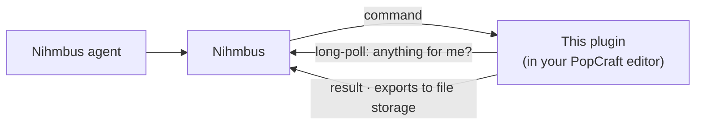

# Nihmbus for PopCraft

[](https://github.com/getpopcraft/popcraft-plugin-nihmbus/actions/workflows/ci.yml)
[](LICENSE)

A [PopCraft](https://popcraft.app) plugin that connects your editor to [Nihmbus](https://nihmbus.ai), so your Nihmbus
agents can design, animate and export right in the file you have open: on popcraft.app or in the desktop app.

This is the PopCraft side of the connection. The Nihmbus side is the
[PopCraft extension for Nihmbus](https://github.com/nihmbus/nihmbus-popcraft), which gives agents the tools and the
skills to use them.

## How it works



The plugin asks Nihmbus for work, runs each command with the
[PopCraft plugin API](https://popcraft.app/docs/plugins/api-reference), and sends the result back. **Every
connection goes out from the plugin; nothing listens on your machine**, so it works the same in a browser tab and in
the sandboxed App Store app.

## Use it

1. In Nihmbus, install the **PopCraft** extension, then open **Extensions → PopCraft → Connect PopCraft** to get a
   code.
2. In PopCraft, install this plugin: main menu → **Manage plugins…** → search **Nihmbus** → **Install**. Or download
   the `.json` from [Releases](https://github.com/getpopcraft/popcraft-plugin-nihmbus/releases) and use **Installed →
   Install from file…**.
3. Run **Plugins → Nihmbus → Connect** and enter the code.
4. Leave the plugin running while agents work:
   - **Hide panel** keeps it connected.
   - Closing the panel, the tab or the app disconnects. Run **Connect** again to reconnect; no new code is needed.
   - **Disconnect** (here or in Nihmbus) ends the pairing for good.

For a Nihmbus server other than nihmbus.ai (development or self-hosting), choose **Use a different server** in the
panel. The address must be `https://`, or `http://localhost`.

## What agents can do

| Tool     | What it does                                                                                     |
| -------- | ------------------------------------------------------------------------------------------------ |
| `status` | Report the current page, its layers and the selection.                                           |
| `call`   | Run plugin API methods on the open file, from a fixed allowlist of 95 (up to 50 per call).       |
| `export` | Render a layer as PNG, JPG, WEBP, SVG or PDF and upload it to the storage link Nihmbus provides. |

The full contract is in [docs/tools.md](docs/tools.md).

## Security and privacy

| Permission      | Why it's needed                                                               |
| --------------- | ----------------------------------------------------------------------------- |
| `read`, `write` | Agents read and edit designs in the open file.                                |
| `export`        | Agents export layers.                                                         |
| `network`       | The plugin talks to Nihmbus and uploads exports to the link Nihmbus gives it. |

- **Allowlisted methods only.** Agents can't open UI or new documents, read the plugin's storage, open links, upload
  anywhere else, or change site settings. The plugin refuses any method that isn't on the list, even if Nihmbus asked
  for it.
- **The connection token stays on your device**, in this plugin's private storage. It is only ever sent to the Nihmbus
  server you connected to, and never to agents.
- **Only you.** Nihmbus lets only the user who connected this editor send it work. You can disconnect it from either
  side at any time.

## Limitations

- **No video or AI yet.** Video export (MP4/GIF) and PopCraft's AI generation aren't in the plugin API yet, so agents
  build the animation and leave the final video export to you.
- **The plugin has to keep running.** A plugin stops when PopCraft quits or its panel closes, and browsers may freeze
  a background tab after a while. Pinning the PopCraft tab helps.

## Develop

No build step: [`main.js`](main.js) and [`ui.html`](ui.html) are the plugin, exactly as PopCraft loads it.

```sh
npm install
npm test                 # the connector against a mock PopCraft and a mock Nihmbus
npm run lint             # ESLint, Prettier and markdownlint
npm run pack             # dist/popcraft.nihmbus-<version>.json, installable from file
node scripts/contract-check.mjs ../nihmbus-popcraft/nihmbus.extension.json   # matches the extension's contract
```

```text
manifest.json            the PopCraft plugin manifest
main.js                  the connector: pairing, polling, the tools (a createConnector factory the tests load)
ui.html                  the panel
docs/tools.md            the tool contract, shared with the extension
scripts/pack.mjs         builds the installable bundle and checks versions agree
scripts/contract-check.mjs  compares the tools, protocol and allowlist with the extension's manifest
scripts/set-version.mjs  sets the version in manifest.json, main.js and package.json (used by the release)
scripts/publish.mjs      publishes to the PopCraft marketplace (used on promote)
test/                    node:test tests, no dependencies
```

**Releases** are automatic from [Conventional Commits](https://www.conventionalcommits.org) with
[tishlang/sem](https://github.com/tishlang/sem): merging to `main` makes a prerelease with the bundle attached, and
promoting it publishes to the PopCraft marketplace. See [CONTRIBUTING.md](CONTRIBUTING.md). If a change breaks
[docs/tools.md](docs/tools.md), bump `EXTENSION_PROTOCOL` here and `device.protocol` in the extension together.

## Related

- [nihmbus/nihmbus-popcraft](https://github.com/nihmbus/nihmbus-popcraft): the Nihmbus extension.
- [Extension devices](https://github.com/nihmbus/nihmbus/blob/main/docs/extension-devices.md): the relay protocol this
  plugin speaks.
- [PopCraft plugin docs](https://popcraft.app/docs/plugins).

## License

[MIT](LICENSE)
